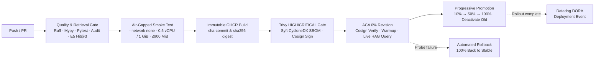
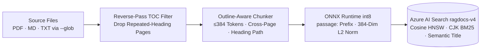
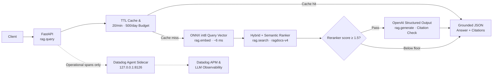
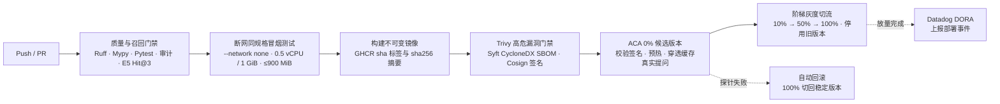
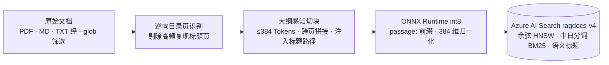
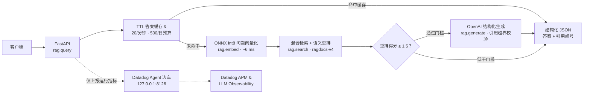
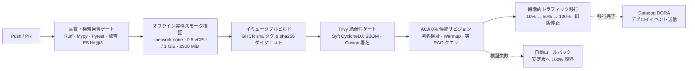
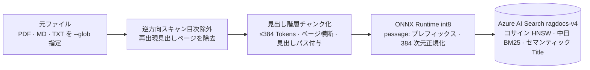
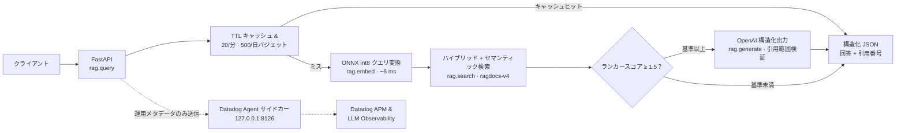

https://github.com/user-attachments/assets/9f8eba90-27e7-4d21-a647-44e635995587

# Serverless Multilingual RAG on Azure

[](https://github.com/workHMZ/aca-ghcr-cicd-lab/actions/workflows/ci.yml)
[](https://github.com/workHMZ/aca-ghcr-cicd-lab/actions/workflows/security.yml)
[](https://www.python.org/)
[](https://github.com/workHMZ/aca-ghcr-cicd-lab/releases/tag/v3.2.1)

An applied engineering lab exploring how supply-chain-verified CI/CD, Azure zero-cost serverless compute, and multilingual hybrid Retrieval-Augmented Generation co-evolve as a single system.

[English](#english) · [中文](#中文) · [日本語](#日本語)

| Lab Snapshot · v3.2.1 | Measured State |
|---|---|
| Release & runtime | [v3.2.1](https://github.com/workHMZ/aca-ghcr-cicd-lab/releases/tag/v3.2.1) · Python 3.14.10 · ONNX Runtime 1.31.1 · uv 0.13.7 · Terraform 1.17.2 |
| Live deployment | Azure Container Apps · Japan East · `serverless-rag-api--0000055` at 100% traffic · verified 2026-11-12 |
| Quality & security gates | **125 tests passed · 91.78% branch coverage** · 0 `pip-audit` and Trivy HIGH/CRITICAL findings · verified 2026-11-12 |
| Offline container smoke | `0.5 vCPU / 1 GiB` with `--network none` · `/health` and `/ready` in **4 s** · **488 MiB** RSS; **518 MiB** with `ddtrace-run` |
| Retrieval benchmark | **96% / 98%** Page Hit Rate@1 / @3 · **0.967** MRR@10 across 50 `zh` / `ja` / `en` queries on `ragdocs-v4` |
| Cold start & Azure spend | **21.255 s** scale-from-zero median · **~6 ms** query embedding · **¥0** Azure infrastructure bill |

---

<details>
<summary>Repository layout</summary>

```text
├── app/
│   ├── config.py                          # Validated Pydantic runtime settings
│   ├── model_manifest.py                  # Pinned Hugging Face revision + SHA-256 manifest & downloader
│   ├── embed.py                           # E5 query/passage encoder on ONNX Runtime int8, 384-dim
│   ├── chunking.py                        # Outline-aware cross-page chunking & TOC page removal
│   ├── guardrails.py                      # In-process TTL answer cache & per-minute/daily query budgets
│   ├── search_client.py                   # Cached read-only Azure AI Search client
│   ├── telemetry.py                       # Metadata-only Datadog workflow, retrieval & LLM spans
│   ├── main.py                            # Async FastAPI service, reranker gate & structured citations
│   └── __main__.py                        # Container entrypoint; activates ddtrace-run only on demand
├── eval/
│   ├── golden_corpus.jsonl                # 50 page-labelled zh/ja/en questions over the real corpus
│   ├── corpus.jsonl                       # Synthetic multilingual passages for offline CI regression
│   └── golden.jsonl                       # Expected passage bindings for offline CI regression
├── scripts/
│   ├── create_index.py                    # Versioned ragdocs-v4 schema: HNSW + CJK BM25 + semantic title
│   ├── ingest.py                          # Idempotent PDF/MD/TXT ingestion with --glob and --dry-run
│   ├── clear_index.py                     # Confirmed document purge for target search index
│   ├── evaluate_retrieval.py              # Local model regression & per-mode Azure ablation with calibration
│   ├── smoke_container.sh                 # Air-gapped 0.5 vCPU / 1 GiB container boot & memory gate
│   ├── deploy_canary.sh                   # Progressive ACA traffic shifting & automated rollback
│   ├── verify.sh                          # Unified local & CI gate: Ruff, Mypy, pip-audit, Pytest
│   ├── setup-azure.sh                     # Initial Azure bootstrap with free-tier resource caps
│   ├── sync_datadog_catalog.sh            # Datadog Service Catalog metadata sync
│   └── send_datadog_dora_deployment.sh    # Datadog DORA deployment event emitter
├── .github/workflows/
│   ├── ci.yml                             # Quality → offline smoke → digest build → Trivy → SBOM → Cosign
│   ├── cd.yml                             # OIDC login → Cosign verify → live-query canary → rollback
│   └── security.yml                       # CodeQL plus filesystem, Terraform, secret & container Trivy gates
├── terraform/                             # Container Apps, Log Analytics quota & GitHub OIDC identity as code
├── assets/videos/                         # Launch overview videos in English and Japanese
├── service.datadog.yaml                   # Datadog Service Catalog definition
└── pyproject.toml                         # Locked dependencies and strict linter/typecheck configuration
```

</details>

---

<a id="english"></a>

## English

### Experimental Scope

`aca-ghcr-cicd-lab` began as a delivery sandbox for GitHub Actions, GitHub Container Registry, and Azure Container Apps. Over successive iterations it grew into a vertical systems experiment driven by a single constraint: **run a public, multilingual RAG API inside Azure's free consumption tiers while holding delivery security, observability, and retrieval precision to production standards.**

Treating infrastructure, model serving, and retrieval as one coupled problem forced design choices across every layer:

- **CI/CD shapes runtime trust**: Every push to `main` must pass an offline multilingual embedding regression gate and boot air-gapped inside a `0.5 vCPU / 1 GiB` container under a `900 MiB` memory ceiling before an image digest is ever signed. CD verifies that exact workflow signature via Cosign and runs an authenticated live RAG query against a `0%`-traffic revision before shifting user traffic.
- **Azure free-tier ceilings shape inference**: Replacing PyTorch fp32 with ONNX Runtime int8 cut the compressed container image from `736 MB` to `220 MB`, shrank replica sizing from `1.5 vCPU / 3 GiB` to `0.5 vCPU / 1 GiB`, tripled monthly free-grant runtime hours, and kept the Azure bill at **¥0**.
- **Corpus geometry shapes RAG retrieval**: Moving from page-level text splits to outline-aware cross-page chunks, stripping table-of-contents pages, and pairing CJK word-level analyzers with HNSW vectors and semantic reranking lifted `Page Hit Rate@1` on a 50-question `zh` / `ja` / `en` benchmark from `84%` to `96%`.

---

### Iterative Progression: `v1.0` → `v3.2.1`

Each release addressed a concrete bottleneck measured in the preceding stage:

1. **Stage 1 · `v1.0–v2.0` · Container Delivery Foundation**
   Built the initial FastAPI RAG service with local CPU PyTorch embeddings on `all-MiniLM-L6-v2`, immutable GHCR digest publishing, Trivy scanning, CycloneDX SBOM attestation, Cosign keyless signing, progressive `0% → 10% → 50% → 100%` ACA canary rollouts, and Datadog APM + DORA tracking.
   *Measured bottleneck*: The English-centric encoder hit only `0.50` top-1 recall on Japanese queries, while the `736 MB` compressed PyTorch image required `1.5 vCPU / 3 GiB` per replica and needed roughly `60 s` to cold-start from zero.

2. **Stage 2 · `v3.0` · Multilingual Hybrid Search & IaC**
   Switched to pinned `384`-dimensional `intfloat/multilingual-e5-small` with asymmetric `query:` and `passage:` prefixes, introduced hybrid BM25 + HNSW + Azure AI Search semantic ranking, enforced OpenAI Structured Outputs inside untrusted-evidence boundaries, and codified ACA + GitHub OIDC federation in Terraform.
   *Measured bottleneck*: Building a 50-question real-corpus benchmark exposed clear retrieval ceilings: page-bound splits severed multi-page answers at `84%` `Page Hit Rate@1`, table-of-contents pages polluted `14%` of top-5 results because listed headings matched every keyword, and `standard.lucene` split Chinese into single characters. Meanwhile, `1.5 vCPU / 3 GiB` exhausted Azure's monthly free grant in roughly `33` active hours.

3. **Stage 3 · `v3.1` · Structure-Aware RAG & ONNX Free-Tier Co-Design**
   Rebuilt ingestion around document outlines with automatic TOC page removal that cut top-5 TOC noise from `14%` to `0%`. Created `ragdocs-v4` with dedicated `zh-Hans.microsoft` and `ja.microsoft` lexical fields, lifting BM25 `Hit@1` from `72%` to `80%` and semantic `Hit@1` from `84%` to `96%` with `MRR@10` reaching `0.967`. Calibrated a `1.5` semantic reranker floor so off-topic queries skip OpenAI completely. Simultaneously replaced PyTorch, `transformers`, SciPy, and `470 MB` fp32 weights with ONNX Runtime, `tokenizers`, and the `118 MB` int8 export, shrinking the compressed image to `220 MB` inside a `0.5 vCPU / 1 GiB` replica.

4. **Stage 4 · `v3.2–v3.2.1` · Fail-Closed Hardening, LLM Telemetry & Toolchain Refresh**
   Enforced fail-closed handling when semantic ranking errors or omits scores, isolated serving onto a read-only `AZURE_SEARCH_QUERY_KEY`, gated canary cache bypass behind a constant-time `X-Canary-Token` secret, stripped `pip` and `ensurepip` from the runtime image, added metadata-only Datadog LLM Observability spans across `rag.query`, `rag.embed`, `rag.search`, and `rag.generate`, upgraded the stack to Python `3.14.10` and ONNX Runtime `1.31.1`, and removed unintended `ddtrace` imports from the untraced cold-start path.

| Dimension | `v3.0` Baseline | `v3.2.1` Current State |
|---|---|---|
| Embedding runtime | PyTorch fp32 + `sentence-transformers` | ONNX Runtime `1.31.1` int8 + `tokenizers` |
| Compressed image size | `736 MB` | **`~220 MB`** |
| Replica resource quota | `1.5 vCPU / 3 GiB` | **`0.5 vCPU / 1 GiB`** app; `1 vCPU / 2 GiB` with optional Datadog sidecar |
| Air-gapped `0.5 vCPU / 1 GiB` smoke RSS | Exceeded `1 GiB` budget | **`488 MiB`** untraced in `4 s`; **`518 MiB`** traced in `6 s` |
| Scale-from-zero cold start | `~60 s` in ACA system logs | **`21.255 s` median** across `20.263–23.191 s`; `/ready` within `50 ms` |
| Real-corpus `Page Hit Rate@1 / @3` | `84% / 94%` on `ragdocs-v3` | **`96% / 98%`** on `ragdocs-v4` |
| Real-corpus `MRR@10` | `0.900` | **`0.967`** |
| `en / ja / zh` `Page Hit Rate@1` | `69% / 83% / 92%` | **`100% / 92% / 96%`** |
| TOC pages in top-5 results | `14%` | **`0%`** |
| Observability | Datadog APM + DORA events | APM + DORA + privacy-preserving `rag.*` workflow & token spans |

---

### Co-Designing CI/CD, Azure Serverless, and RAG

#### 1. From Commit to Azure Canary: Supply Chain & State Boundaries



- **Production-equivalent CI gates**: `ci.yml` runs `scripts/verify.sh`, executes `scripts/evaluate_retrieval.py --backend local` through the production ONNX int8 encoder to require `Page Hit Rate@3 = 1.0` across `zh` / `ja` / `en` and `MRR ≥ 0.9`, validates GitHub workflows and Terraform, and boots the built image twice via `scripts/smoke_container.sh` with `--network none --cpus 0.5 --memory 1g`, testing both default startup and `DD_TRACE_ENABLED=true` while asserting that `pip` and `ensurepip` are absent, the baked-in ONNX model warms up offline, and RSS stays below `900 MiB`.
- **Ordered supply-chain signing**: `build-scan-sign-push` scans the exact immutable `sha256` digest with Trivy, attaches a CycloneDX SBOM attestation via Syft + Cosign, and executes `cosign sign` as the very last step so a partially failed CI run never produces a deployable signature.
- **Cryptographic handoff & cache-bypassing canary**: `cd.yml` authenticates to Azure via `stg`-scoped OIDC federated credentials and verifies the exact CI workflow identity, `refs/heads/main`, and commit SHA with `cosign verify` and `cosign verify-attestation`. It pins the active stable revision to `100%`, deploys the candidate revision at `0%`, and invokes `scripts/deploy_canary.sh`. Beyond `/health` and `/warmup`, the canary sends a live RAG request carrying `X-Canary-Token` to bypass the answer cache and verify Azure AI Search retrieval, OpenAI structured synthesis, and grounded citations end to end before stepping traffic through `10% → 50% → 100%` and deactivating older revisions.
- **Clean Terraform / CD ownership split**: Terraform provisions the Resource Group, Log Analytics quota, Container Apps Environment, probe definitions, secret bindings, and Microsoft Entra OIDC federation while ignoring `image`, `traffic_weight`, `registry`, and `secret` drift via `lifecycle.ignore_changes` so infrastructure reconciles cleanly without clobbering canary state.

#### 2. Fitting Inside Azure's Zero-Cost Envelope

| Service | Monthly Free Allowance | Architectural Adaptation |
|---|---|---|
| Azure Container Apps Consumption | `180,000 vCPU-s`, `360,000 GiB-s`, `2M` requests | `min_replicas = 0`, `max_replicas = 1`, `0.5 vCPU / 1 GiB` yields ~100 active replica-hours per month, or ~50 hours with the optional Datadog sidecar; `300 s` scale-down cooldown supports ~1,200 cold visits per month |
| Azure AI Search Free | `50 MB` storage, `3` indexes, monthly semantic ranker quota | `ragdocs-v4` occupies `3.2 MB` across `521` chunks by setting `stored=False` on `contentVector`; answer cache and daily query cap protect semantic ranker quota, and HTTP `402` quota exhaustion fails closed before LLM calls |
| Azure Monitor Log Analytics | `5 GB` ingestion, `31`-day retention | `30`-day retention plus a `0.16 GB/day` workspace quota in Terraform and `setup-azure.sh`; verbose `azure.*` SDK HTTP logging is silenced to `WARNING` inside the app |
| GitHub Container Registry | Free for public repositories | Public immutable digests pulled directly by ACA without registry credentials |

Azure Cost Management recorded **¥0** across the resource group from June through September 2026. OpenAI generation remains the sole metered external call, bounded simultaneously by the `3600 s` TTL answer cache, a `20 req/min` token bucket, a `500 req/day` UTC ceiling returning `429 Retry-After`, and the `1.5` semantic reranker score floor.

#### 3. Restructuring the Multilingual RAG Pipeline

##### Document Ingestion Pipeline



- **TOC elimination & outline-aligned chunking · `app/chunking.py`**: Technical interview PDFs begin with multi-page tables of contents whose entries match nearly every question lexically while holding zero answers. `detect_toc_pages` scans pages in reverse and drops pages where at least `60%` of five or more detected headings reappear later in the body. `_HeadingTracker` then cuts chunks along top-level numbered, chapter, and Markdown headings up to `384` tokens with `48`-token overlap, keeps numbered sub-points inside their parent question, merges answers cleanly across page breaks, slices raw text via token character offsets without tokenizer re-decoding, and prepends the hierarchical heading path as `title` during `passage:` embedding.
- **Language-specific lexical copies & vector lineage · `scripts/create_index.py`**: Because `standard.lucene` splits Chinese text into individual characters, `ragdocs-v4` pairs a language-neutral `content` field with hidden `contentZh` analyzed by `zh-Hans.microsoft` and `contentJa` analyzed by `ja.microsoft` for word-segmented BM25, fused via Reciprocal Rank Fusion with `384`-dim cosine HNSW vectors at `m=4`, `efConstruction=400`, and `efSearch=500` across `50` candidates before semantic reranking over `title` and `content`. Every indexed document stores `embeddingModel`, `embeddingRevision`, and `embeddingVariant`; the API rejects any mismatched chunk at query time to prevent mixing incompatible vector spaces.

##### Online Query & Telemetry Pipeline



- **Ablation & reranker floor calibration**: Evaluated on `2026-09-26` against all `521` chunks in `ragdocs-v4` across `50` page-labelled questions covering `25 zh`, `12 ja`, and `13 en`, single-mode `Page Hit Rate@1` progressed from **80%** on CJK-segmented BM25 to **82%** on dense HNSW vectors, **84%** on hybrid RRF, and **96%** with the semantic ranker, reaching **98%** `Page Hit Rate@3` and **0.966667** `MRR@10`. Across the benchmark, the lowest annotated positive hit scored `1.90` on the `0–4` semantic scale while off-topic probes peaked between `0.50` and `1.61`; setting `SEARCH_MIN_RERANKER_SCORE=1.5` retains every benchmark hit while returning a localized insufficient-evidence response for out-of-domain queries without calling OpenAI.
- **Untrusted-evidence synthesis & citation verification · `app/main.py`**: Surviving chunks are serialized into a JSON evidence array explicitly marked as untrusted data so prompt-like strings inside documents are ignored. `responses.parse` enforces a `GeneratedAnswer` Pydantic schema in the caller's `auto`, `zh`, `ja`, or `en` language setting, and the service verifies that every `1`-based citation index falls within `1` through the retained context count before marking the response grounded.
- **Privacy-preserving LLM observability · `app/telemetry.py`**: When the optional Datadog Agent sidecar is deployed, CD enables `ddtrace-run` and `DD_LLMOBS_ENABLED` automatically while keeping `DD_TRACE_OPENAI_ENABLED=false` and agentless mode off. Verified live on `2026-09-27` via `127.0.0.1:8126`, Datadog records four structured spans covering `rag.query`, `rag.embed`, `rag.search`, and `rag.generate` with stage latency, cache/refusal/grounded flags, retained chunk counts, min/max reranker scores, and input/output/cached/reasoning token counts, without capturing user questions, generated answers, or corpus text.

---

### Engineering Trade-offs

- **ONNX int8 vs. PyTorch fp32**: Serving the pinned `onnx-qint8` export cuts resident embedding memory from roughly `1.2 GB` to `0.3 GB` and settles at `488 MiB` total container RSS after warmup, unlocking `0.5 vCPU / 1 GiB` replicas while matching fp32 retrieval within a single query. Because quantized kernels must match across indexing and querying, `ragdocs-v4` enforces `embeddingVariant` equality on every hit.
- **Scale-to-zero vs. warm standby**: Setting `min_replicas = 0` drops idle compute cost to zero at the price of a `~21 s` cold start after the `300 s` idle window. Background model preloading decouples `/health` from `/ready` so container startup never stalls liveness probes; latency-critical workloads can set `min_replicas = 1` outside the free grant.
- **In-process guardrails vs. external gateway**: Keeping the TTL answer cache and rate/daily budgets inside the Python process adds zero infrastructure cost and remains exact while `max_replicas = 1`. Horizontal multi-replica scaling would move state to Redis or Azure API Management.
- **Opt-in Datadog sidecar vs. replica hours**: Enabling `enable_datadog_sidecar = true` attaches `datadog-agent` inside the same replica, doubling total allocation to `1 vCPU / 2 GiB` and halving free-tier runtime hours in exchange for full trace correlation and LLM token metrics.
- **Auditable shell canary vs. cluster controller**: Implementing progressive traffic shifting in `scripts/deploy_canary.sh` keeps revision pinning, authenticated cache-bypass queries, and automatic rollback readable line by line in GitHub Actions logs without maintaining cluster-side operators.

---

<details>
<summary>Runbook & Environment Reference</summary>

### Runbook

#### 1. Local Environment Setup

```bash
uv sync --frozen --dev
cp .env.example .env
# Populate AZURE_SEARCH_ENDPOINT, AZURE_SEARCH_QUERY_KEY, and OPENAI_API_KEY in .env
```

On first local run, `app/model_manifest.py` downloads the pinned tokenizer and ONNX int8 weights into `~/.cache/serverless-rag` and verifies every file against hardcoded SHA-256 digests. Container builds bake these verified files into `/opt/models/multilingual-e5-small` and run with `EMBEDDING_OFFLINE=1`.

#### 2. Index Creation & Document Ingestion

```bash
# Create versioned schema using AZURE_SEARCH_ADMIN_KEY
uv run python scripts/create_index.py --index-name ragdocs-v4

# Preview outline chunking and TOC removal without embedding or uploading
uv run python scripts/ingest.py --data-dir data --glob '*.pdf' --dry-run

# Ingest selected public documents idempotently and prune stale chunks per source
uv run python scripts/ingest.py --data-dir data --glob '*.pdf' --index-name ragdocs-v4
```

Every ingested passage can be returned verbatim in API citations; always scope files explicitly with `--glob` and keep private notes out of `data/`. Passing `--prune-missing` without `--glob` additionally deletes indexed sources no longer present in `--data-dir`.

#### 3. Local API Execution & Probing

```bash
uv run uvicorn app.main:app --host 127.0.0.1 --port 8000

curl -fsS http://127.0.0.1:8000/health
curl -fsS http://127.0.0.1:8000/ready

curl -fsS http://127.0.0.1:8000/query \
  -H 'Content-Type: application/json' \
  --data '{"question": "How does HashMap handle collisions in Java 8?", "top_k": 3, "language": "en"}'
```

`POST /query` accepts `language` as `"auto"`, `"zh"`, `"ja"`, or `"en"`, binding both answer synthesis and localized fallback messages as well as the cache key.

#### 4. Retrieval Evaluation & Calibration

```bash
# Real-corpus ablation & reranker floor calibration on Azure AI Search
uv run python scripts/evaluate_retrieval.py --backend azure --index-name ragdocs-v4 \
  --mode semantic --mode hybrid --mode vector --mode bm25

# Offline CI regression gate comparing English MiniLM baseline vs. production ONNX int8 E5
uv run python scripts/evaluate_retrieval.py \
  --backend local \
  --model sentence-transformers/all-MiniLM-L6-v2 --revision 1110a243fdf4706b3f48f1d95db1a4f5529b4d41 \
  --model intfloat/multilingual-e5-small --revision 614241f622f53c4eeff9890bdc4f31cfecc418b3
```

#### 5. Local Verification Gate

```bash
uv run bash scripts/verify.sh
```

Executes the exact CI quality checks: `ruff format --check`, `ruff check`, strict `mypy`, `pip-audit` against the exported runtime lockfile, `pytest` with an `80%` branch-coverage floor, bytecode compilation, and `git diff --check`.

#### 6. Deployment Prerequisites & Manual Rollback

Automated CD requires Azure OIDC federation bound to the GitHub `stg` environment, a read-only `azure-search-query-key` secret and `canary-cache-bypass-token` secret stored in Container Apps, and an identical `CANARY_CACHE_BYPASS_TOKEN` secret in GitHub. While `deploy_canary.sh` rolls back automatically on failure, traffic can also be pinned manually:

```bash
az containerapp revision activate --name <app-name> --resource-group <resource-group> --revision <stable-revision>
az containerapp ingress traffic set \
  --name <app-name> \
  --resource-group <resource-group> \
  --revision-weight <stable-revision>=100
```

### Environment Variable Reference

| Variable | Default | Purpose |
|---|---|---|
| `AZURE_SEARCH_ENDPOINT` | `-` | Azure AI Search endpoint URL |
| `AZURE_SEARCH_QUERY_KEY` | `-` | Read-only query key used by the serving app and Azure evaluation |
| `AZURE_SEARCH_ADMIN_KEY` | `-` | Admin key used exclusively by `create_index.py`, `ingest.py`, and `clear_index.py` |
| `AZURE_SEARCH_INDEX_NAME` | `ragdocs-v4` | Active index queried by the FastAPI application |
| `AZURE_SEARCH_INDEX_NAME_V4` | `ragdocs-v4` | Target index operated on by offline CLI scripts |
| `SEARCH_MIN_RERANKER_SCORE` | `1.5` | Calibrated `0–4` semantic score floor; weaker hits are discarded pre-LLM |
| `SEARCH_TOP_K_DEFAULT` / `SEARCH_TOP_K_MAX` | `5` / `10` | Default and upper bound for `top_k` per query |
| `OPENAI_API_KEY` | `-` | OpenAI API credential |
| `OPENAI_MODEL` | `gpt-5.6-terra` | Responses API model identifier |
| `OPENAI_REASONING_EFFORT` | `low` | Reasoning token effort level |
| `EMBEDDING_MODEL` / `EMBEDDING_MODEL_REVISION` | `intfloat/multilingual-e5-small` / `614241f...` | Locked to `app/model_manifest.py`; mismatches abort startup |
| `EMBEDDING_VARIANT` | `onnx-qint8` | Served ONNX export, either `onnx-qint8` or `onnx-fp32`, enforced against indexed chunks |
| `EMBEDDING_MODEL_PATH` | `-` | Preloaded model directory in container images; falls back to `~/.cache/serverless-rag` |
| `EMBEDDING_OFFLINE` | `false` | Set to `true` or `1` in production images to forbid runtime model downloads |
| `EMBEDDING_THREADS` | `1` | ONNX Runtime intra-op threads; sized to match the `0.5 vCPU` container quota |
| `EMBEDDING_BATCH_SIZE` | `16` | Passage batch size during ingestion |
| `ANSWER_CACHE_TTL_SECONDS` | `3600` | In-process answer cache TTL in seconds; `0` disables caching |
| `QUERY_RATE_LIMIT_PER_MINUTE` / `QUERY_DAILY_LIMIT` | `20` / `500` | Per-replica uncached query budgets; `0` disables either limit |
| `CANARY_CACHE_BYPASS_TOKEN` | `-` | Shared secret matching `X-Canary-Token` to force live RAG execution during canary checks |
| `DD_TRACE_ENABLED` / `DD_LLMOBS_ENABLED` | `false` | Opt-in Datadog APM and metadata-only LLM spans; enabled automatically by CD when the Agent sidecar is present |
| `DD_LLMOBS_ML_APP` | `serverless-rag-api` | Application identifier in Datadog LLM Observability |

</details>

---

<a id="中文"></a>

## 中文

### 实验背景与定位

`aca-ghcr-cicd-lab` 最初是一个围绕 GitHub Actions、GHCR 与 Azure Container Apps 搭建的容器交付实验场。随着迭代推进，它演进为一项纵向贯通的系统工程实验，核心命题非常明确：**在 Azure 零基础设施账单的免费层配额内，能否同时跑通具备供应链签名验证的金丝雀发布、容器级离线资源门禁，以及高精度中英日多语言混合检索 RAG？**

把交付流水线、云端计算配额与检索链路放进同一个约束条件里求解时，三者会直接相互塑形：

- **用 CI/CD 约束模型与容器边界**：每次向 `main` 提交代码，必须先通过离线多语言向量召回回归门禁，并在断网、`0.5 vCPU / 1 GiB`、`900 MiB` 内存红线下完成真实容器冷启动冒烟测试，镜像摘要才会获得 Cosign 签名。CD 阶段在校验工作流签名后，先向 `0%` 流量的候选版本发送携带鉴权令牌的真实 RAG 请求穿透缓存，确认检索引擎与结构化生成全部正常后才开始灰度切流。
- **用 Azure 免费配额倒逼推理瘦身**：将本地向量推理从 PyTorch fp32 彻底替换为 ONNX Runtime int8，压缩镜像体积从 `736 MB` 降至 `220 MB`，单副本配额从 `1.5 vCPU / 3 GiB` 压至 `0.5 vCPU / 1 GiB`，免费时长翻了三倍，实现 Azure 资源组实测 **¥0** 花费。
- **用文档结构重塑多语言检索**：放弃粗暴的按页硬切，改为识别文档大纲跨页切块并剥离目录页噪声，在 `ragdocs-v4` 中组合中日文分词级 BM25、余弦 HNSW 向量与语义重排，使真实语料 50 题跨语言评测的 `Page Hit Rate@1` 从 `84%` 提升至 **`96%`**。

---

### 演进脉络：从初版流水线到 `v3.2.1`

项目的每一次大版本演进，都直接对应上一阶段实测暴露出的工程瓶颈：

1. **阶段一 · `v1.0–v2.0` · 容器化与安全灰度基座**
   搭建 FastAPI 异步服务骨架，引入基于 CPU 版 PyTorch 的 `all-MiniLM-L6-v2` 本地向量化，打通 GHCR 不可变摘要推送、Trivy 漏洞门禁、Syft CycloneDX SBOM 证明、Cosign 无密钥签名、`0% → 10% → 50% → 100%` 渐进式金丝雀发布与自动回滚，并接入 Datadog APM 与 DORA 部署指标。
   *暴露出的瓶颈*：单语英文模型在日文查询上的 Top-1 召回率仅有 `0.50`；包含 PyTorch 的压缩镜像高达 `736 MB`，单副本至少需要 `1.5 vCPU / 3 GiB`，从零扩容的冷启动耗时约 `60 秒`。

2. **阶段二 · `v3.0` · 多语言混合检索与基础设施即代码**
   切换至固定版本的 `intfloat/multilingual-e5-small` `384` 维多语言模型并统一 `query:` / `passage:` 非对称前缀；接入 Azure AI Search 混合检索与语义重排序；基于 OpenAI Structured Outputs 建立不可信证据隔离与引用校验；使用 Terraform 纳管 Container Apps 环境与 GitHub OIDC 联合身份。
   *暴露出的瓶颈*：构建覆盖中英日 50 道真实语料评测集后发现，`Page Hit Rate@1` 停留在 `84%`，且前 5 名召回结果中有 `14%` 被目录页占据，原因在于目录页罗列了全书标题，词法匹配极高却不含正文解答；同时按页切分截断了跨页长答案，`standard.lucene` 又将中文拆成单字削弱了 BM25 精度。而在资源侧，`1.5 vCPU / 3 GiB` 每月仅能支撑约 `33` 小时免费运行。

3. **阶段三 · `v3.1` · 结构感知 RAG 梳理与 ONNX 免费层适配**
   *检索侧重构*：实现逆向扫描目录页剔除算法，将目录页污染从 `14%` 清零；按章节与题号大纲跨页切块并注入标题路径；新建 `ragdocs-v4` 索引，补充 `zh-Hans.microsoft` 与 `ja.microsoft` 专属分词字段，使单 BM25 `Hit@1` 从 `72%` 升至 `80%`，叠加向量与语义重排后整体 `Page Hit Rate@1` 跃升至 **`96%`**、`MRR@10` 达 **`0.967`**；同时根据正负样本得分分布标定 `1.5` 分重排门槛，让离题提问直接短路返回，不再消耗大模型额度。
   *运行时瘦身*：从生产镜像彻底移除 PyTorch、`transformers`、SciPy 与 `470 MB` fp32 权重，改用 ONNX Runtime、`tokenizers` 与 `118 MB` 官方 int8 导出权重，镜像缩减至 `220 MB`，应用容器稳态运行在 `0.5 vCPU / 1 GiB` 配额内，免费可用时长提升至每月约 `100` 小时，单核查询向量化仅需约 `6 ms`。

4. **阶段四 · `v3.2–v3.2.1` · 故障闭锁加固、无正文遥测与工具链焕新**
   补齐边界防护：当语义重排报错或缺失评分时立即终止生成；将在线检索与评测收紧为只读 `AZURE_SEARCH_QUERY_KEY`，与管理端密钥彻底物理隔离；为金丝雀缓存穿透引入常量时间比对的 `X-Canary-Token` 鉴权；从运行时镜像剥离 `pip` 与 `ensurepip` 消除自带打包器攻击面；通过既有 Datadog 边车补齐仅采集耗时与 Token 指标的 `rag.*` 四段追踪；并在 `v3.2.1` 升级至 Python `3.14.10`、ONNX Runtime `1.31.1` 与 `ddtrace 4.16.4`，清理了未开启追踪时日志格式化器误导入 `ddtrace` 的冷启动开销。

| 对比维度 | `v3.0` 基线状态 | `v3.2.1` 当前实测 |
|---|---|---|
| 向量推理运行时 | PyTorch fp32 + `sentence-transformers` | ONNX Runtime `1.31.1` int8 + `tokenizers` |
| 压缩后镜像体积 | `736 MB` | **`~220 MB`** |
| 单副本资源配额 | `1.5 vCPU / 3 GiB` | 应用 **`0.5 vCPU / 1 GiB`**；挂载可选 Datadog 边车时为 `1 vCPU / 2 GiB` |
| 断网冒烟预热后内存 | 超出 `1 GiB` 配额 | 默认模式 `4 s` 就绪、**`488 MiB`**；开启追踪 `6 s` 就绪、**`518 MiB`** |
| 从零扩容冷启动耗时 | 系统日志约 `60 秒` | 3 轮实测中位数 **`21.255 秒`**，区间 `20.263–23.191 秒`，随后 `50 ms` 内 `/ready` 就绪 |
| 真实语料 `Page Hit Rate@1 / @3` | `84% / 94%` · `ragdocs-v3` | **`96% / 98%`** · `ragdocs-v4` |
| 真实语料 `MRR@10` | `0.900` | **`0.967`** |
| `en / ja / zh` 分语种 `Hit@1` | `69% / 83% / 92%` | **`100% / 92% / 96%`** |
| Top-5 目录页误召回占比 | `14%` | **`0%`** |
| 可观测性深度 | Datadog APM + DORA 事件 | APM + DORA + 不落盘任何正文的 `rag.*` 分段耗时与 Token 追踪 |

---

### 系统融合：从 CI/CD、Azure 适配到 RAG 梳理

#### 1. 从代码提交到 Azure 金丝雀：供应链闭环与状态边界



- **同规格离线容器门禁**：`ci.yml` 在完成 `scripts/verify.sh` 与本地 ONNX 多语言召回回归测试后，调用 `scripts/smoke_container.sh` 以 `--network none --cpus 0.5 --memory 1g` 连续启动两次容器，分别验证默认模式与 `DD_TRACE_ENABLED=true` 追踪模式，断言基础环境不含 `pip` 与 `ensurepip`、内置 ONNX 模型可在完全断网下完成预热，且常驻内存严格低于 `900 MiB`。
- **后置授权签名防半成品发布**：构建任务针对推送后的精确 `sha256` 镜像摘要依次完成 Trivy `HIGH/CRITICAL` 扫描与 Syft CycloneDX SBOM 证明绑定，最后一步才执行 `cosign sign`；任何前置门禁失败都不会产出可被 CD 接受的签名。
- **OIDC 验签交接与真实流量金丝雀**：`cd.yml` 通过绑定 `stg` 环境的 Azure OIDC 联合身份无密钥登录，先用 `cosign verify` 与 `cosign verify-attestation` 校验镜像确实出自当前仓库 `refs/heads/main` 的指定提交；随后将线上稳定版本流量锁定为 `100%`，以 `0%` 权重拉起新版本并执行 `scripts/deploy_canary.sh`。金丝雀探针不仅检查 `/health` 与 `/warmup`，还会附带 `X-Canary-Token` 请求头强制绕过进程内缓存，执行一次完整命中 Azure AI Search 与 OpenAI 的真实问答并校验引用有效性，通过后才按 `10% → 50% → 100%` 推进流量并停用历史活跃版本，任一步骤异常即自动切回原稳定版本。
- **Terraform 与 CD 职责解耦**：Terraform 负责声明资源组、Log Analytics 配额、Container Apps 环境、探针策略、密钥引用与 Microsoft Entra OIDC 信任关系，同时通过 `lifecycle.ignore_changes` 忽略 `image`、`traffic_weight`、`registry` 与 `secret` 变更，让基础设施巡检与高频金丝雀发版互不覆盖。

#### 2. 面向 Azure 免费额度的云原生资源适配

| 云服务 | 月度免费额度 | 架构适配策略 |
|---|---|---|
| Azure Container Apps Consumption | `180,000 vCPU-s`、`360,000 GiB-s`、`200 万`次请求 | 设定 `min_replicas = 0`、`max_replicas = 1`、应用配额 `0.5 vCPU / 1 GiB`，免费额度可覆盖约 `100` 副本小时，启用可选 Datadog 边车时约 `50` 小时；按 `300 秒` 缩容冷却期折算每月可支撑约 `1,200` 次冷启动访问 |
| Azure AI Search Free | `50 MB` 存储、`3` 个索引、每月固定语义重排免费次数 | `ragdocs-v4` 将 `contentVector` 设为 `stored=False` 省去冗余向量存储，`521` 个文本块仅占 `3.2 MB`；答案缓存与每日请求上限共同保护语义重排额度，遇到 HTTP `402` 额度耗尽或重排异常时直接闭锁止损 |
| Azure Monitor Log Analytics | `5 GB` 日志摄取、`31` 天保留期 | 统一设定 `30` 天保留期与每日 `0.16 GB` 工作区配额上限，并在应用内将高频打印请求头的 `azure.*` SDK 日志级别调至 `WARNING` |
| GitHub Container Registry | 公开仓库镜像免费托管与拉取 | 采用公开不可变摘要镜像，ACA 直接拉取，省去私有镜像仓库费用与凭据轮换 |

Azure Cost Management 账单显示，项目资源组在 2026 年 6 月至 9 月期间基础设施支出为 **¥0**。外部唯一按量计费点为 OpenAI 生成接口，由 `3600 秒` TTL 答案缓存、每分钟 `20` 次令牌桶限流、每日 `500` 次 UTC 配额上限以及 `1.5` 分语义重排门槛四重机制联合收敛。

#### 3. 多语言 RAG 链路的系统化梳理

##### 数据摄取链路



- **目录页清洗与大纲跨页切块 · `app/chunking.py`**：技术题库与手册类 PDF 往往包含数页目录，其中密集的章节标题会与几乎所有用户提问产生高词法匹配，但没有任何实质解答。`detect_toc_pages` 自后向前遍历文档，凡单页包含至少 5 个标题且 `60%` 以上在后文重新作为正文标题出现的页面均被判定为目录页直接剔除。随后 `_HeadingTracker` 追踪 Markdown、章节与数字编号层级，在一级标题边界处切分出上限 `384` tokens、重叠 `48` tokens 的语义块，保证小题要点留在所属母题内部、长解答自然跨越页码边界，并通过分词器字符偏移量直接切片原文避免重解码失真，最后在 `passage:` 向量化前自动拼入层级标题路径。
- **中日双语词法增强与向量空间强校验 · `scripts/create_index.py`**：针对 `standard.lucene` 将中文切为单字的问题，`ragdocs-v4` 在保留通用 `content` 字段供客户端展示与语义重排读取的同时，新增基于 `zh-Hans.microsoft` 分词的隐藏字段 `contentZh` 与基于 `ja.microsoft` 分词的隐藏字段 `contentJa` 提供词级 BM25 召回，与 `384` 维余弦 HNSW 向量经 RRF 融合召回前 `50` 个候选，再交由语义重排器结合 `title` 与 `content` 精排。每个文档块均写入 `embeddingModel`、`embeddingRevision` 与 `embeddingVariant` 元数据，在线服务遇到任何版本不一致的索引片段会立即拒绝返回，杜绝新旧向量空间混用。

##### 在线检索、证据门控与遥测链路



- **多模式消融实测与重排阈值标定**：2026-09-26 基于 `ragdocs-v4` 内 `521` 个真实 Java 语料片段，使用覆盖中文 `25` 题、日文 `12` 题、英文 `13` 题共 `50` 道人工标注页码的跨语言问题完成消融评测：单检索模式 `Page Hit Rate@1` 从词法 BM25 的 **80%**、纯向量检索的 **82%**、混合 RRF 的 **84%** 一路提升至语义重排后的 **96%**，`Page Hit Rate@3` 达 **98%**，`MRR@10` 达 **0.966667**。校准统计显示，全部命中样本的最低语义重排得分为 `1.90`，而离题干扰问题的最高得分落在 `0.50–1.61` 区间；线上据此将 `SEARCH_MIN_RERANKER_SCORE` 定为 `1.5`，在不损失任何有效命中的前提下拦截无关提问，直接按提问语种返回资料不足提示并省去大模型调用。
- **不可信证据隔离与引用边界验证 · `app/main.py`**：通过门槛的检索片段被封装进结构化 JSON 证据数组，系统提示词明确声明所有证据字段均为不可信原始数据以抵御文档内提示词注入；`responses.parse` 强制按 `auto`、`zh`、`ja`、`en` 语言设定返回 `GeneratedAnswer` 结构，服务端随后核验全部引用序号均落在 `1` 至保留片段总数的合法区间内且无越界编号后，才将其标记为有效支撑回答。
- **零正文采集的 LLM 链路追踪 · `app/telemetry.py`**：当启用可选 Datadog Agent 边车时，CD 自动激活 `ddtrace-run` 与 `DD_LLMOBS_ENABLED`，同时显式关闭 OpenAI 自动正文采集与无代理上报。经 2026-09-27 线上实测验证，`serverless-rag-api` 通过本地 `127.0.0.1:8126` 稳定上报 `rag.query`、`rag.embed`、`rag.search`、`rag.generate` 四级调用链，完整记录分段耗时、保留片段数、语义得分上下界以及输入/输出/缓存/推理 Token 用量，全程不记录用户问题、生成答案与知识库原文。

---

### 关键工程取舍

- **ONNX int8 对比 PyTorch fp32**：采用锁定版本自带的 `onnx-qint8` 权重后，向量会话常驻内存增量从约 `1.2 GB` 降至约 `0.3 GB`，整容器预热后内存稳定在 `488 MiB`，为 `0.5 vCPU / 1 GiB` 规格腾出充足余量，同时与 fp32 在评测集上的差距不超过 1 题；相应约束是索引构建与在线查询必须保持相同的 `embeddingVariant`。
- **缩容至零对比常驻副本**：`min_replicas = 0` 让空闲期云资源成本归零，代价是超过 `300 秒` 空闲冷却期后的首个请求需等待约 `21 秒` 冷启动。服务在后台线程异步预加载 ONNX 模型，使 `/health` 存活探针即刻响应、`/ready` 就绪探针仅做内存标志位检查，避免每次探测触发推理。
- **进程内护栏对比外部 API 网关**：在 `max_replicas = 1` 的单副本拓扑下，进程内 TTL 缓存、令牌桶与日配额计数器无需任何外部存储即可实现精确限流且完全免费；若未来扩展为多副本水平伸缩，则应下沉至 Redis 或 Azure API Management。
- **可选 Datadog 边车对比免费时长预算**：开启 `enable_datadog_sidecar = true` 会在同一副本内挂载 `0.5 vCPU / 1 GiB` 的 Agent 边车，整副本资源翻倍至 `1 vCPU / 2 GiB`，免费运行配额随之减半，适合在需要深度排障与观测实验时按需开启。
- **透明 Shell 金丝雀对比集群控制器**：`scripts/deploy_canary.sh` 将稳定版本锁定、穿透缓存实测提问、阶梯切流与异常回滚全部写成可直接审阅的 Shell 流程，无需维护额外集群组件即可在 GitHub Actions 日志中逐行追溯每次发版状态。

---

<details>
<summary>运维手册与环境变量参考</summary>

### 运维手册

#### 1. 本地环境初始化

```bash
uv sync --frozen --dev
cp .env.example .env
# 编辑 .env，填入 AZURE_SEARCH_ENDPOINT、AZURE_SEARCH_QUERY_KEY 与 OPENAI_API_KEY
```

本地首次运行时，`app/model_manifest.py` 会自动将锁定版本的分词器与 ONNX int8 模型下载至 `~/.cache/serverless-rag` 并逐文件校验 SHA-256；Docker 构建阶段则将其预置进 `/opt/models/multilingual-e5-small` 并默认开启 `EMBEDDING_OFFLINE=1` 断网运行。

#### 2. 索引创建与语料摄取

```bash
# 使用 AZURE_SEARCH_ADMIN_KEY 创建版本化索引
uv run python scripts/create_index.py --index-name ragdocs-v4

# 干跑预览目录页剔除与大纲切块结果，不执行向量化与上传
uv run python scripts/ingest.py --data-dir data --glob '*.pdf' --dry-run

# 幂等摄取指定公开文档，并自动清理同一来源下的过期旧块
uv run python scripts/ingest.py --data-dir data --glob '*.pdf' --index-name ragdocs-v4
```

摄取进索引的文本会通过公开接口作为引用上下文原样返回，务必通过 `--glob` 精确指定公开资料，切勿混入私人笔记。当整个索引目录均由 `--data-dir` 托管且未传 `--glob` 时，可额外传入 `--prune-missing` 清理已从本地删除的历史来源文档。

#### 3. 本地启动与接口验证

```bash
uv run uvicorn app.main:app --host 127.0.0.1 --port 8000

curl -fsS http://127.0.0.1:8000/health
curl -fsS http://127.0.0.1:8000/ready

curl -fsS http://127.0.0.1:8000/query \
  -H 'Content-Type: application/json' \
  --data '{"question": "Java 中 HashMap 的工作原理是什么？", "top_k": 3, "language": "zh"}'
```

`POST /query` 支持传入 `"auto"`、`"zh"`、`"ja"` 或 `"en"` 作为 `language` 字段，统一控制生成语言、资料不足兜底文案与答案缓存键。

#### 4. 检索评测与阈值校准

```bash
# 连接 Azure AI Search 对真实语料执行四模式消融评测并输出重排阈值校准表
uv run python scripts/evaluate_retrieval.py --backend azure --index-name ragdocs-v4 \
  --mode semantic --mode hybrid --mode vector --mode bm25

# 运行离线合成集回归门禁：对比单语 MiniLM 基线与线上同款 ONNX int8 多语言模型
uv run python scripts/evaluate_retrieval.py \
  --backend local \
  --model sentence-transformers/all-MiniLM-L6-v2 --revision 1110a243fdf4706b3f48f1d95db1a4f5529b4d41 \
  --model intfloat/multilingual-e5-small --revision 614241f622f53c4eeff9890bdc4f31cfecc418b3
```

#### 5. 本地全量质量门禁

```bash
uv run bash scripts/verify.sh
```

一键执行与 CI 完全一致的静态与单测门禁：`ruff format --check`、`ruff check`、严格模式 `mypy`、基于锁定运行时依赖的 `pip-audit` 漏洞扫描、分支覆盖率下限 `80%` 的 `pytest`、字节码编译检查与空白字符校验。

#### 6. 部署前置条件与手动回滚

自动化 CD 依赖绑定到 GitHub `stg` 环境的 Azure OIDC 联合凭据，需预先在 Container Apps 密钥中配置只读 `azure-search-query-key` 与 `canary-cache-bypass-token`，并在 GitHub Secrets 中配置同值的 `CANARY_CACHE_BYPASS_TOKEN`。金丝雀探测失败会自动回滚；如需人工干预切回指定稳定版本：

```bash
az containerapp revision activate --name <app-name> --resource-group <resource-group> --revision <stable-revision>
az containerapp ingress traffic set \
  --name <app-name> \
  --resource-group <resource-group> \
  --revision-weight <stable-revision>=100
```

### 环境变量参考

| 变量名 | 默认值 | 用途说明 |
|---|---|---|
| `AZURE_SEARCH_ENDPOINT` | `-` | Azure AI Search 服务端点 URL |
| `AZURE_SEARCH_QUERY_KEY` | `-` | 在线服务与 Azure 检索评测使用的只读查询密钥 |
| `AZURE_SEARCH_ADMIN_KEY` | `-` | 仅供 `create_index.py`、`ingest.py`、`clear_index.py` 使用的管理密钥，严禁注入在线容器 |
| `AZURE_SEARCH_INDEX_NAME` | `ragdocs-v4` | 在线 FastAPI 服务读取的目标索引名 |
| `AZURE_SEARCH_INDEX_NAME_V4` | `ragdocs-v4` | 离线管理与评测脚本默认操作的目标索引名 |
| `SEARCH_MIN_RERANKER_SCORE` | `1.5` | 经评测标定的 `0–4` 语义重排分数门槛，低于此值的片段在进入大模型前丢弃 |
| `SEARCH_TOP_K_DEFAULT` / `SEARCH_TOP_K_MAX` | `5` / `10` | 单次查询返回上下文数量的默认值与上限 |
| `OPENAI_API_KEY` | `-` | OpenAI API 鉴权密钥 |
| `OPENAI_MODEL` | `gpt-5.6-terra` | 答案结构化生成所使用的模型 ID |
| `OPENAI_REASONING_EFFORT` | `low` | 生成阶段的推理预算档位 |
| `EMBEDDING_MODEL` / `EMBEDDING_MODEL_REVISION` | `intfloat/multilingual-e5-small` / `614241f...` | 锁定于 `app/model_manifest.py`，环境覆盖不一致时直接拒绝启动 |
| `EMBEDDING_VARIANT` | `onnx-qint8` | 启用的 ONNX 权重变体，必须与索引内记录的 `embeddingVariant` 一致 |
| `EMBEDDING_MODEL_PATH` | `-` | 容器内置模型目录；本地留空时默认使用 `~/.cache/serverless-rag` |
| `EMBEDDING_OFFLINE` | `false` | 设为 `true` 或 `1` 时禁止运行时联网下载模型文件 |
| `EMBEDDING_THREADS` | `1` | ONNX Runtime 算子内并行线程数，匹配 `0.5 vCPU` 容器配额避免核间争用 |
| `EMBEDDING_BATCH_SIZE` | `16` | 文档摄取阶段的批量向量化大小 |
| `ANSWER_CACHE_TTL_SECONDS` | `3600` | 进程内答案缓存存活秒数，设为 `0` 关闭缓存 |
| `QUERY_RATE_LIMIT_PER_MINUTE` / `QUERY_DAILY_LIMIT` | `20` / `500` | 单副本未命中缓存的每分钟与每日查询配额，设为 `0` 关闭对应限制 |
| `CANARY_CACHE_BYPASS_TOKEN` | `-` | 与请求头 `X-Canary-Token` 匹配的共享密钥，用于金丝雀阶段穿透缓存执行真实检索生成 |
| `DD_TRACE_ENABLED` / `DD_LLMOBS_ENABLED` | `false` | 可选 Datadog APM 与无正文 LLM 追踪开关；检测到 Agent 边车时由 CD 自动开启 |
| `DD_LLMOBS_ML_APP` | `serverless-rag-api` | Datadog LLM Observability 中标识的应用名称 |

</details>

---

<a id="日本語"></a>

## 日本語

### 実験の背景と位置づけ

`aca-ghcr-cicd-lab` は、GitHub Actions・GHCR・Azure Container Apps を結ぶコンテナ配信の実験環境として出発し、段階的な改修を経てひとつの統合システム実験へと発展しました。掲げている問いは明快です。**サプライチェーン署名検証を備えたカナリア配信、コンテナ単位のオフライン起動ゲート、そして中・英・日対応の高精度ハイブリッド RAG を、Azure のインフラ課金ゼロの無料枠内でどこまで高水準に両立できるか。**

配信パイプライン・クラウドの無料枠制約・検索パイプラインを同一の制約条件のもとで設計したことで、3 つの軸が互いにアーキテクチャを規定し合っています：

- **CI/CD がランタイム境界を保証する**：`main` へのすべての Push は、オフライン多言語 Embedding 回帰ゲートを通過し、さらにネットワーク遮断・`0.5 vCPU / 1 GiB`・メモリ上限 `900 MiB` の実コンテナスモークテストをクリアしない限り署名されません。CD は Cosign でワークフロー署名を検証した後、`0%` トラフィックの新リビジョンへキャッシュバイパス認証付きの実 RAG クエリを投げ、検索と生成の疎通を確認してから段階的にトラフィックを切り替えます。
- **Azure 無料枠が推論ランタイムを規定する**：ローカル Embedding を PyTorch fp32 から ONNX Runtime int8 へ移行したことで、圧縮イメージを `736 MB` から `220 MB` へ縮小し、レプリカ構成を `1.5 vCPU / 3 GiB` から `0.5 vCPU / 1 GiB` へ削減、月間の無料稼働時間を 3 倍に伸ばして Azure インフラ請求 **¥0** を維持しています。
- **文書構造の整理が検索精度を引き上げる**：ページ境界での単純分割を廃止し、見出し階層に沿ったページ横断チャンク化と目次ページの自動除外を導入。`ragdocs-v4` で中国語・日本語の形態素レベル BM25、コサイン HNSW ベクトル、セマンティックランカーを組み合わせた結果、実コーパス 50 問ベンチマークの `Page Hit Rate@1` は `84%` から **`96%`** へ向上しました。

---

### 段階的な改善プロセス：`v1.0` → `v3.2.1`

各リリースは、前段階で計測された具体的なボトルネックを解消する形で進められました：

1. **第 1 段階 · `v1.0–v2.0` · コンテナ配信とカナリア基盤の構築**
   FastAPI と CPU 版 PyTorch 上の `all-MiniLM-L6-v2` で初期 RAG API を構築し、GHCR へのイミュータブルダイジェスト Push、Trivy スキャン、Syft CycloneDX SBOM 証明、Cosign キーレス署名、`0% → 10% → 50% → 100%` の段階的カナリア移行と自動ロールバック、Datadog APM および DORA メトリクス連携を整備。
   *計測された課題*：英語中心のモデルでは日本語クエリの Top-1 到達率が `0.50` にとどまり、PyTorch を含む圧縮イメージは `736 MB` に達し、レプリカあたり `1.5 vCPU / 3 GiB` を要してゼロからのコールドスタートに約 `60 秒` かかっていました。

2. **第 2 段階 · `v3.0` · 多言語ハイブリッド検索と Terraform IaC 化**
   リビジョン固定の `intfloat/multilingual-e5-small` と `query:` / `passage:` 非対称プレフィックスへ移行し、Azure AI Search のハイブリッド検索＋セマンティックランカー、OpenAI Structured Outputs による非信頼コンテキスト隔離と引用検証を導入。Container Apps と GitHub OIDC 連携を Terraform でコード化。
   *計測された課題*：実コーパスに対する中・日・英 50 問の評価セットを作成して測定したところ、`Page Hit Rate@1` は `84%` で頭打ちとなり、上位 5 件の `14%` を目次ページが占めていました。目次には全章の見出しが並ぶため語彙一致スコアだけが高く、肝心の回答本文を含まないためです。またページ単位の分割がページをまたぐ回答を分断し、`standard.lucene` が中国語を 1 文字単位に分解して BM25 精度を下げていました。さらに `1.5 vCPU / 3 GiB` 構成では月約 `33` 時間で無料枠を使い切る計算でした。

3. **第 3 段階 · `v3.1` · 構造認識型 RAG への再設計と ONNX 無料枠最適化**
   *RAG パイプラインの刷新*：逆方向スキャンによる目次ページ除外アルゴリズムで目次ノイズを `14% → 0%` に解消。設問・章見出しに沿ったページ横断チャンク化と見出しパスの付与を実装し、`zh-Hans.microsoft` と `ja.microsoft` の専用語彙フィールドを備えた `ragdocs-v4` を構築。BM25 単体の `Hit@1` を `72% → 80%`、セマンティック再順位付け込みの `Page Hit Rate@1` を **`96%`**、`MRR@10` を **`0.967`** へ引き上げました。さらに評価分布からセマンティックスコア下限 `1.5` を校正し、無関係な質問では OpenAI 呼び出し自体をスキップする仕組みを導入。
   *ランタイムの軽量化*：イメージから PyTorch・`transformers`・SciPy と `470 MB` の fp32 重みを完全に外し、ONNX Runtime・`tokenizers`・`118 MB` の公式 int8 重みへ置換。圧縮イメージは `220 MB` へ縮小し、`0.5 vCPU / 1 GiB` レプリカで月約 `100` 時間の無料稼働が可能になり、クエリ Embedding も 1 スレッド約 `6 ms` に収まりました。

4. **第 4 段階 · `v3.2–v3.2.1` · フェイルクローズ強化・LLM 可観測性・ツールチェーン刷新**
   セマンティック検索の障害やスコア欠落時に生成を即座に止めるフェイルクローズ制御、オンライン検索と評価における読み取り専用キー `AZURE_SEARCH_QUERY_KEY` の徹底、定数時間比較の `X-Canary-Token` によるカナリアキャッシュバイパス認証、ランタイムイメージからの `pip` / `ensurepip` 除去を実施。さらに Datadog Agent サイドカー経由で本文を一切収集しない `rag.*` スパン計測を追加し、`v3.2.1` では Python `3.14.10`・ONNX Runtime `1.31.1`・`ddtrace 4.16.4` への更新と非トレース時の不要な `ddtrace` 読み込み除去を完了しました。

| 比較項目 | `v3.0` ベースライン | `v3.2.1` 現在の実測値 |
|---|---|---|
| Embedding ランタイム | PyTorch fp32 + `sentence-transformers` | ONNX Runtime `1.31.1` int8 + `tokenizers` |
| 圧縮イメージサイズ | `736 MB` | **`~220 MB`** |
| レプリカ割り当てリソース | `1.5 vCPU / 3 GiB` | アプリ単体 **`0.5 vCPU / 1 GiB`**；任意の Datadog サイドカー併用時 `1 vCPU / 2 GiB` |
| オフライン起動後の常駐メモリ | `1 GiB` 上限を超過 | 通常時 `4 s` 起動・**`488 MiB`**；トレース有効時 `6 s` 起動・**`518 MiB`** |
| ゼロからのコールドスタート | システムログ記録で約 `60 秒` | 3 回実測中央値 **`21.255 秒`**、範囲 `20.263–23.191 秒`、直後 `50 ms` 以内に `/ready` 通過 |
| 実コーパス `Page Hit Rate@1 / @3` | `84% / 94%` · `ragdocs-v3` | **`96% / 98%`** · `ragdocs-v4` |
| 実コーパス `MRR@10` | `0.900` | **`0.967`** |
| `en / ja / zh` 言語別 `Hit@1` | `69% / 83% / 92%` | **`100% / 92% / 96%`** |
| Top-5 内の目次ページ混入率 | `14%` | **`0%`** |
| 可観測性 | Datadog APM + DORA イベント | APM + DORA + 本文非収集の `rag.*` ステージ遅延・Token トレース |

---

### システム統合：CI/CD・Azure 適合・RAG 再設計の融合

#### 1. コミットから Azure カナリア配信まで：サプライチェーン検証と責務分離



- **本番レプリカ同一条件のスモークゲート**：`ci.yml` は `scripts/verify.sh` と本番同一 ONNX int8 エンコーダーによる多言語検索回帰ゲートを通過した後、`scripts/smoke_container.sh` で `--network none --cpus 0.5 --memory 1g` のコンテナを通常構成と `DD_TRACE_ENABLED=true` 構成の 2 パターンで起動し、`pip` / `ensurepip` の不在、オフラインでのモデルロード完了、ウォームアップ後のメモリ使用量 `900 MiB` 以下を検証します。
- **最終段階でのデプロイ承認署名**：ビルドされた `sha256` ダイジェストに対して Trivy の `HIGH/CRITICAL` 検査と Syft CycloneDX SBOM アテステーションを完了させた後、ジョブの最終ステップで `cosign sign` を実行するため、途中失敗した CI 実行からデプロイ可能な署名付きイメージが残ることはありません。
- **OIDC 署名検証とキャッシュバイパス実クエリ検証**：`cd.yml` は `stg` 環境スコープの Azure OIDC フェデレーション資格情報でログインし、`cosign verify` と `cosign verify-attestation` で対象イメージが `refs/heads/main` の該当コミットから生成されたことを検証します。続いて稼働中の安定リビジョンを `100%` に固定した上で候補リビジョンを `0%` で作成し、`scripts/deploy_canary.sh` から `X-Canary-Token` ヘッダー付きの実クエリを送信して回答キャッシュをバイパスさせ、Azure AI Search と OpenAI を通貫した根拠付き応答を確認してから `10% → 50% → 100%` へ段階移行し、旧リビジョンを非アクティブ化します。
- **Terraform と CD の明確な境界設計**：Terraform はリソースグループ、Log Analytics クォータ、Container Apps 環境、プローブ設定、シークレット参照、Microsoft Entra OIDC 信頼ポリシーを管理しつつ、`lifecycle.ignore_changes` によって `image`・`traffic_weight`・`registry`・`secret` を CD 側の管轄に委ね、IaC の再適用がカナリア状態を上書きしない構造を保ちます。

#### 2. Azure 無料枠に収めるリソース設計

| サービス | 月間無料枠 | アーキテクチャ上の適合策 |
|---|---|---|
| Azure Container Apps Consumption | `180,000 vCPU 秒`、`360,000 GiB 秒`、`200 万`リクエスト | `min_replicas = 0`・`max_replicas = 1`・アプリ `0.5 vCPU / 1 GiB` により月約 `100` レプリカ時間、任意の Datadog サイドカー併用時でも約 `50` 時間を無料枠でカバー；`300 秒` クールダウン換算で月約 `1,200` 回のコールド訪問に対応 |
| Azure AI Search Free | `50 MB` 容量、`3` インデックス、月間セマンティックランカー無料枠 | `contentVector` を `stored=False` に設定し、`521` チャンクの `ragdocs-v4` 全体を `3.2 MB` に圧縮；回答キャッシュと日次クエリ上限でランカー枠を保護し、HTTP `402` 枠超過やスコア欠落時は LLM 呼び出し前に停止 |
| Azure Monitor Log Analytics | `5 GB` 取り込み、`31` 日保持 | `30` 日保持と日次 `0.16 GB` のワークスペース上限を設定し、リクエストごとにヘッダーを出力する `azure.*` SDK ロガーをアプリ内で `WARNING` に抑制 |
| GitHub Container Registry | パブリックリポジトリは無料 | パブリックなイミュータブルダイジェストを ACA から認証情報なしで直接取得 |

Azure Cost Management 上、対象リソースグループの 2026 年 6 月〜 9 月のインフラ請求額は **¥0** です。従量課金が発生する外部依存は OpenAI のみであり、`3600 秒` TTL の回答キャッシュ、毎分 `20` 件のトークンバケット、毎日 `500` 件の UTC 上限、およびセマンティックスコア下限 `1.5` の 4 層で制御しています。

#### 3. 多言語 RAG パイプラインの体系的整理

##### ドキュメント取り込みパイプライン



- **目次ページ除外と見出し構造チャンク化 · `app/chunking.py`**：技術系 PDF の冒頭にある目次ページは、文書全体の見出し語を網羅するためあらゆる質問に語彙一致しつつ回答を含みません。`detect_toc_pages` はページを末尾から逆順に走査し、5 件以上の見出しを含みその `60%` 以上が後続ページで実際の見出しとして再出現するページを目次と判定して除外します。続いて `_HeadingTracker` が番号付き見出し・章見出し・Markdown 見出しの階層を追跡し、最大 `384` トークン・オーバーラップ `48` トークンでトップレベル設問ごとに分割、小項目を親設問内に保持したままページ境界をまたいで結合します。本文はトークンの文字オフセットで原文から直接切り出して再デコードによる正規化崩れを防ぎ、`passage:` ベクトル化時に階層見出しパスを先頭へ補います。
- **言語別語彙フィールドとベクトル互換性強制 · `scripts/create_index.py`**：`standard.lucene` が中国語を 1 文字単位に分割する弱点を補うため、`ragdocs-v4` では表示・セマンティック用の `content` に加え、`zh-Hans.microsoft` アナライザーによる非表示フィールド `contentZh` と `ja.microsoft` アナライザーによる非表示フィールド `contentJa` を持たせて単語単位の BM25 を実現し、`384` 次元コサイン HNSW ベクトルと RRF で上位 `50` 件を統合した上で、`title` と `content` を参照するセマンティックランカーで再順位付けします。全チャンクに `embeddingModel`・`embeddingRevision`・`embeddingVariant` を記録し、オンライン検索時に不一致があれば即座に拒否して異なるベクトル空間の混在を防ぎます。

##### オンライン検索・根拠ゲート・テレメトリパイプライン



- **検索モード別アブレーションと下限スコア校正**：2026-09-26 に `ragdocs-v4` 上の Java 技術資料 `521` チャンクに対し、中国語 `25` 問・日本語 `12` 問・英語 `13` 問の計 `50` 問からなる回答ページ付き評価セットで測定を実施しました。単一モードの `Page Hit Rate@1` は語彙 BM25 の **80%**、HNSW ベクトルの **82%**、ハイブリッド RRF の **84%** から、セマンティック再順位付け適用時に **96%** へ到達し、`Page Hit Rate@3` は **98%**、`MRR@10` は **0.966667** を記録しました。正解ヒットの最小セマンティックスコアが `1.90` であったのに対し、無関係な質問の最高スコアは `0.50–1.61` に収まったため、本番しきい値を `SEARCH_MIN_RERANKER_SCORE=1.5` に設定し、正解チャンクを取りこぼさずに領域外の質問を LLM 呼び出し前で遮断して質問言語に応じた根拠不足メッセージを返します。
- **非信頼エビデンス隔離と引用インデックス検証 · `app/main.py`**：しきい値を通過したチャンクは JSON エビデンス配列に格納され、システムプロンプト上で文書内の命令文やロール指定を無視するよう明示してプロンプトインジェクションを抑止します。`responses.parse` で `auto`・`zh`・`ja`・`en` の言語指定に沿った `GeneratedAnswer` スキーマを強制し、返却された引用番号がすべて `1` から採用チャンク数までの範囲内に収まっていることをアプリ側で検証してから有効な根拠付き回答として採用します。
- **本文を保持しない LLM オブザーバビリティ · `app/telemetry.py`**：任意の Datadog Agent サイドカーを有効化すると、CD が自動で `ddtrace-run` と `DD_LLMOBS_ENABLED` を有効化しつつ、OpenAI の自動プロンプト収集とエージェントレス送信を無効のまま維持します。2026-09-27 の本番検証にて、`127.0.0.1:8126` 経由で `rag.query`・`rag.embed`・`rag.search`・`rag.generate` の 4 スパン、各段階の所要時間、採用チャンク数、セマンティックスコア範囲、入出力・キャッシュ・推論トークン数が質問文や回答本文を一切含めずに記録されることを確認済みです。

---

### 設計上のトレードオフ

- **ONNX int8 と PyTorch fp32**：固定リビジョン同梱の `onnx-qint8` を使うことで、Embedding セッションの常駐メモリ増加を約 `1.2 GB` から約 `0.3 GB` へ抑え、コンテナ全体をウォームアップ後 `488 MiB` で稼働させて `0.5 vCPU / 1 GiB` 枠を実現しました。ベンチマーク上の差は 1 問以内に収まる一方、インデックス作成と検索で同一の `embeddingVariant` を揃える制約が生じます。
- **ゼロスケールと常時ウォーム待機**：`min_replicas = 0` によりアイドル時のクラウド課金はゼロになりますが、`300 秒` の縮退後に届く最初のリクエストは約 `21 秒` のコールドスタートを伴います。バックグラウンドでのモデル先読みにより `/health` と `/ready` を分離し、起動プローブのブロッキングと毎回の推論実行を回避しています。
- **プロセス内ガードレールと外部 API ゲートウェイ**：`max_replicas = 1` の単一レプリカ構成では、アプリ内の TTL キャッシュと分次・日次バジェットだけで追加コストなしに正確なレート制御が成立します。複数レプリカへ水平スケールさせる場合は Redis や Azure API Management への移行が必要です。
- **任意の Datadog サイドカーと無料枠稼働時間**：`enable_datadog_sidecar = true` にすると同一レプリカに `0.5 vCPU / 1 GiB` の Agent コンテナが追加され、合計割り当てが `1 vCPU / 2 GiB` となって無料枠で賄える稼働時間が半減するため、トレース計測が必要な実験・検証フェーズに応じて切り替えられる設計としています。
- **シェルスクリプトによるカナリア制御とクラスタオペレーター**：`scripts/deploy_canary.sh` にトラフィック固定・キャッシュバイパス実クエリ検証・自動ロールバックを集約することで、追加のクラスタ常駐コンポーネントを持たずに GitHub Actions のログ上で全遷移を追跡可能にしています。

---

<details>
<summary>運用手順と環境変数リファレンス</summary>

### 運用手順

#### 1. ローカル環境のセットアップ

```bash
uv sync --frozen --dev
cp .env.example .env
# .env に AZURE_SEARCH_ENDPOINT、AZURE_SEARCH_QUERY_KEY、OPENAI_API_KEY を設定
```

ローカルでの初回実行時、`app/model_manifest.py` が固定リビジョンのトークナイザーと ONNX int8 モデルを `~/.cache/serverless-rag` へ取得し、SHA-256 を検証します。コンテナイメージではビルド時に `/opt/models/multilingual-e5-small` へ同梱され、`EMBEDDING_OFFLINE=1` で動作します。

#### 2. インデックス作成とドキュメント投入

```bash
# AZURE_SEARCH_ADMIN_KEY を用いてバージョン付きインデックスを作成
uv run python scripts/create_index.py --index-name ragdocs-v4

# ベクトル化やアップロードを行わずに目次除外とチャンク分割をプレビュー
uv run python scripts/ingest.py --data-dir data --glob '*.pdf' --dry-run

# 指定した公開ドキュメントのみを冪等に投入し、同一ソースの古いチャンクを削除
uv run python scripts/ingest.py --data-dir data --glob '*.pdf' --index-name ragdocs-v4
```

投入されたテキストは公開 API の引用コンテキストとしてそのまま返却されるため、必ず `--glob` で公開対象のファイルだけを明示し、個人メモを `data/` に置かないでください。インデックス全体を `--data-dir` で管理し `--glob` を使わない運用では、`--prune-missing` を付けることで削除済みソースのチャンクも一括整理できます。

#### 3. ローカル起動とエンドポイント確認

```bash
uv run uvicorn app.main:app --host 127.0.0.1 --port 8000

curl -fsS http://127.0.0.1:8000/health
curl -fsS http://127.0.0.1:8000/ready

curl -fsS http://127.0.0.1:8000/query \
  -H 'Content-Type: application/json' \
  --data '{"question": "Javaのガベージコレクションはどのように不要なオブジェクトを判定しますか？", "top_k": 3, "language": "ja"}'
```

`POST /query` は `language` に `"auto"`・`"zh"`・`"ja"`・`"en"` を受け付け、回答言語・根拠不足時のフォールバック文言・キャッシュキーを一貫して切り替えます。

#### 4. 検索精度評価としきい値校正

```bash
# Azure AI Search 上の実コーパスに対する 4 モード比較とリランカー下限の校正出力
uv run python scripts/evaluate_retrieval.py --backend azure --index-name ragdocs-v4 \
  --mode semantic --mode hybrid --mode vector --mode bm25

# オフライン CI 回帰ゲート：英語単言語 MiniLM と本番同一 ONNX int8 E5 の比較
uv run python scripts/evaluate_retrieval.py \
  --backend local \
  --model sentence-transformers/all-MiniLM-L6-v2 --revision 1110a243fdf4706b3f48f1d95db1a4f5529b4d41 \
  --model intfloat/multilingual-e5-small --revision 614241f622f53c4eeff9890bdc4f31cfecc418b3
```

#### 5. ローカル品質ゲート

```bash
uv run bash scripts/verify.sh
```

CI と同一の検査を一括実行します：`ruff format --check`、`ruff check`、strict 設定の `mypy`、エクスポート済みロックに対する `pip-audit`、ブランチカバレッジ下限 `80%` の `pytest`、バイトコードコンパイル検査、および空白差分チェック。

#### 6. デプロイ前提条件と手動ロールバック

自動 CD を動かすには、GitHub の `stg` 環境に紐づく Azure OIDC フェデレーション設定と、Container Apps シークレット上の読み取り専用 `azure-search-query-key` および `canary-cache-bypass-token`、そしてそれと同一値を持つ GitHub Secrets の `CANARY_CACHE_BYPASS_TOKEN` が必要です。カナリア検証失敗時は自動でロールバックされますが、手動で安定リビジョンへ戻す場合は以下を実行します：

```bash
az containerapp revision activate --name <app-name> --resource-group <resource-group> --revision <stable-revision>
az containerapp ingress traffic set \
  --name <app-name> \
  --resource-group <resource-group> \
  --revision-weight <stable-revision>=100
```

### 環境変数リファレンス

| 環境変数 | 既定値 | 役割 |
|---|---|---|
| `AZURE_SEARCH_ENDPOINT` | `-` | Azure AI Search のエンドポイント URL |
| `AZURE_SEARCH_QUERY_KEY` | `-` | サービングアプリと Azure 検索評価が使用する読み取り専用キー |
| `AZURE_SEARCH_ADMIN_KEY` | `-` | `create_index.py`・`ingest.py`・`clear_index.py` 専用の管理キー |
| `AZURE_SEARCH_INDEX_NAME` | `ragdocs-v4` | 稼働中の FastAPI アプリが検索するインデックス名 |
| `AZURE_SEARCH_INDEX_NAME_V4` | `ragdocs-v4` | 管理・評価 CLI スクリプトが対象とするインデックス名 |
| `SEARCH_MIN_RERANKER_SCORE` | `1.5` | 評価セットで校正した `0–4` のセマンティック下限スコア |
| `SEARCH_TOP_K_DEFAULT` / `SEARCH_TOP_K_MAX` | `5` / `10` | クエリあたりの取得コンテキスト数の既定値と上限 |
| `OPENAI_API_KEY` | `-` | OpenAI API 認証キー |
| `OPENAI_MODEL` | `gpt-5.6-terra` | 回答生成に使用するモデル ID |
| `OPENAI_REASONING_EFFORT` | `low` | 生成時の推論バジェット指定 |
| `EMBEDDING_MODEL` / `EMBEDDING_MODEL_REVISION` | `intfloat/multilingual-e5-small` / `614241f...` | `app/model_manifest.py` と照合し、不一致時は起動を中止 |
| `EMBEDDING_VARIANT` | `onnx-qint8` | 推論に用いる ONNX バリアント。インデックス内のチャンクと一致が必須 |
| `EMBEDDING_MODEL_PATH` | `-` | コンテナ内の事前配置モデルパス。未指定時は `~/.cache/serverless-rag` |
| `EMBEDDING_OFFLINE` | `false` | `true` または `1` で実行時のモデルダウンロードを禁止 |
| `EMBEDDING_THREADS` | `1` | ONNX Runtime の演算子内スレッド数。`0.5 vCPU` 枠に合わせて設定 |
| `EMBEDDING_BATCH_SIZE` | `16` | ドキュメント投入時のバッチサイズ |
| `ANSWER_CACHE_TTL_SECONDS` | `3600` | プロセス内回答キャッシュの有効秒数。`0` で無効化 |
| `QUERY_RATE_LIMIT_PER_MINUTE` / `QUERY_DAILY_LIMIT` | `20` / `500` | レプリカあたりの未キャッシュクエリ上限。`0` で無効化 |
| `CANARY_CACHE_BYPASS_TOKEN` | `-` | `X-Canary-Token` ヘッダーと照合してカナリア時にキャッシュをバイパスする共有シークレット |
| `DD_TRACE_ENABLED` / `DD_LLMOBS_ENABLED` | `false` | Datadog APM と本文非収集 LLM トレースの有効化フラグ。サイドカー存在時は CD が自動設定 |
| `DD_LLMOBS_ML_APP` | `serverless-rag-api` | Datadog LLM Observability 上のアプリケーション名 |

</details>
